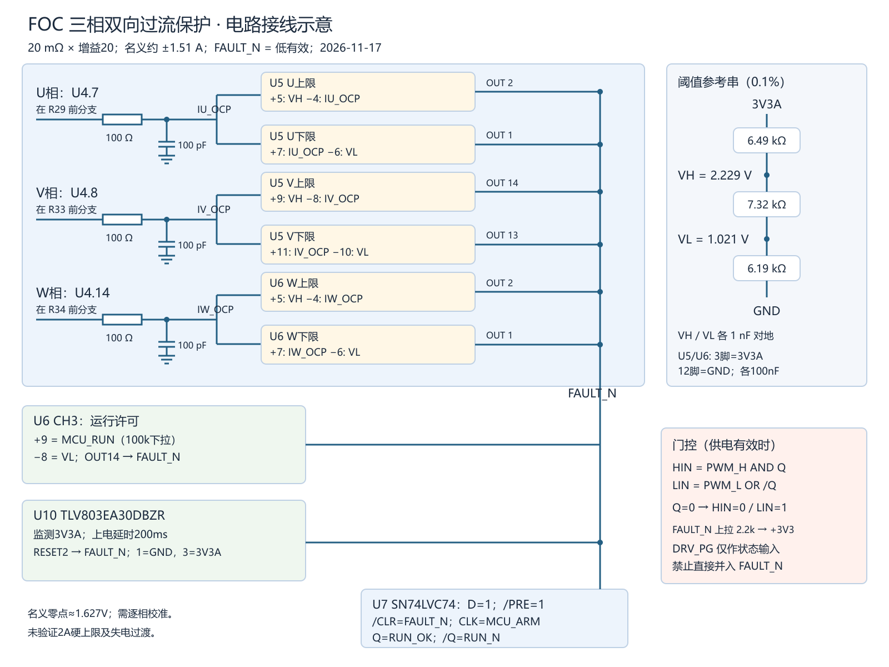

# 原理图修改建议

2026-11-17 · FOC 工程 · 拟新增保护电路

本次新增三相双向过流检测、故障锁存、运行许可、上电禁止、驱动输入门控和母线 TVS，并给出配套的驱动供电方案。复用现有三颗 20 mΩ 低侧分流电阻及 GS8634 放大输出。电源按稳压 12 V、正常最高 12.6 V，电机按额定相电流 0.5 A、瞬时上限 2 A 设计。

**过流门限计算以三路采样增益已改为 20 为前提，名义触发约为 +1.506 A、−1.514 A。** 该门限为原型起点，需要计入前端误差、检测窗口和总关断延迟后验证；不代表相电流已经被保证限制在 2 A 内。长期电流仍按电机额定值及热条件处理。

新增 U5～U11 为建议位号，落图时按整工程统一标注。本文集中列出新增保护电路，现有器件的增益改值不作为整改条目重复列入。

## 一 新增保护电路总览

| 建议位号或用途 | 型号或参数 | 数量 | 作用 |
|---|---|---:|---|
| U5、U6 | TLV9024PWR，TSSOP-14，立创 C3659030 | 2 | 六路组成三相正负过流窗口，另一路检测运行许可 |
| U7 | SN74LVC74APWR | 1 | 故障锁存，过流后必须重新 ARM 才能启动 |
| U8 | SN74LVC08APWR | 1 | 三路高侧输入 AND 门控 |
| U9 | SN74LVC32APWR | 1 | 三路低侧输入 OR 门控 |
| U10 | TLV803EA30DBZR | 1 | 3V3A 欠压及上电禁止，3.08 V 阈值、200 ms 释放延时 |
| U11 | TPS7A1601DGNR | 1 | 推荐的约 10 V 独立驱动供电，配合母线 TVS |
| 母线 TVS | Littelfuse SMCJ13A，单向，SMC，立创 C224040 | 1 | 抑制母线短脉冲过压 |
| 过流参考串 | 6.49 kΩ、7.32 kΩ、6.19 kΩ，均 0.1% | 各 1 | 产生上、下限电压 |
| 比较信号支路 | 100 Ω 串阻、100 pF 对地 | 各 3 | 每相一个小 RC 分支 |
| 参考滤波 | 1 nF 对地 | 2 | 分别滤波 VH、VL |
| 故障线及控制线 | 2.2 kΩ 上拉；MCU_RUN、MCU_ARM 各 100 kΩ 下拉 | 按接线 | 定义故障和控制初态 |



[下载可放大的 SVG 接线图](原理图修改建议_附件/三相过流保护接线图.svg)

## 二 三相双向过流检测

### 信号取点

从放大器输出、ADC 串联电阻之前各分出一条保护支路：

| 相 | 分支取点 | 原 ADC 串阻 | 新保护节点 |
|---|---|---|---|
| U | U4.7 | R29 之前 | IU_OCP |
| V | U4.8 | R33 之前 | IV_OCP |
| W | U4.14 | R34 之前 | IW_OCP |

每路经新增 100 Ω 到比较节点，并预留 100 pF 到安静 GND，时间常数约 10 ns。原 ADC 支路保留。不要为抑制尖峰而直接加大 RC 或加长消隐时间，实际参数由波形和允许关断延迟确定。

### 上下限参考

```text
3V3A ── 6.49 kΩ ── VH ── 7.32 kΩ ── VL ── 6.19 kΩ ── GND
```

三颗均用 0.1%，VH、VL 各并 1 nF 到安静 GND。3V3A 为 3.3 V 时，VH 约 2.22915 V、VL 约 1.02135 V。

20 mΩ 配合增益 20，灵敏度为 0.40 V/A。现有 R26 加载下，理想零流偏置约 1.62676 V，因此上下限分别约对应 +1.506 A 和 −1.514 A。阈值随供电变化，也受分流、放大电阻比和各通道失调影响。软件对 ADC 校零不会自动校正硬件比较门限，样板须逐相测触发电流。

### TLV9024PWR 具体接线

两颗均为 **3 脚接 3V3A、12 脚接 GND**，每颗就近 100 nF 去耦，附近增配 1 µF。以下脚号仅针对 PWR／TSSOP-14 封装。

| 器件及用途 | IN+ | IN− | OUT |
|---|---|---|---|
| U5 U 相上限 | 5 脚接 VH | 4 脚接 IU_OCP | 2 脚 |
| U5 U 相下限 | 7 脚接 IU_OCP | 6 脚接 VL | 1 脚 |
| U5 V 相上限 | 9 脚接 VH | 8 脚接 IV_OCP | 14 脚 |
| U5 V 相下限 | 11 脚接 IV_OCP | 10 脚接 VL | 13 脚 |
| U6 W 相上限 | 5 脚接 VH | 4 脚接 IW_OCP | 2 脚 |
| U6 W 相下限 | 7 脚接 IW_OCP | 6 脚接 VL | 1 脚 |

六个输出直接并为低有效 **FAULT_N**，用 2.2 kΩ 上拉到底板 +3V3。TLV9024 为开漏输出，不能换为推挽 TLV9034 后继续并接。其典型 100 ns 是比较器规定测试条件下的延迟，不是整条保护链速度。管脚及电气特性见 [TI TLV9024 原厂手册](https://www.ti.com/lit/ds/symlink/tlv9024.pdf)。

U6 第三路用于运行许可：9 脚 IN+ 接 MCU_RUN，8 脚 IN− 接 VL，14 脚 OUT 并 FAULT_N。MCU_RUN 用 100 kΩ 下拉，复位、未初始化或核心板拔出时为低，保持停机，不放大电容延迟撤销许可。

U6 第四路未用：11 脚接 VREF，10 脚接 GND，13 脚输出不接。输入不要悬空。

本方案以数字锁存保持第一次故障后的停机状态；近门限最初的误触发仍需通过布线、参考滤波和波形检查解决。公共 FAULT_N 不作未经计算的输入或阈值正反馈。

## 三 故障锁存和上电禁止

### U7 故障锁存

U7 采用 SN74LVC74APWR，底板 +3V3 供电，近端 100 nF。第一路 D 触发器接线如下：

| 脚号 | 连接 |
|---|---|
| 1 /CLR1 | FAULT_N |
| 2 D1 | +3V3 |
| 3 CLK1 | MCU_ARM，100 kΩ 下拉到 GND |
| 4 /PRE1 | +3V3 |
| 5 Q1 | RUN_OK |
| 6 /Q1 | RUN_N |
| 7 | GND |
| 14 | +3V3 |

未用第二路：10、13 脚接 +3V3；11、12 脚接 GND；8、9 脚不接。故障拉低 FAULT_N 后 Q 清零；故障消失后 Q 仍为零，必须新的 ARM 上升沿才能启用。ARM 应在 FAULT_N 稳定为高且 PWM 已初始化到安全电平后发出，满足复位释放与时钟恢复时间。见 [SN74LVC74A 手册](https://www.ti.com/lit/ds/symlink/sn74lvc74a.pdf)。

MCU_RUN 是电平许可，MCU_ARM 是启动脉冲；两者由已确认空闲的 GPIO 引出，并在顶层与核心板接口页补相应端口。

### U10 上电禁止

采用 **TLV803EA30DBZR**，默认 SOT-23 引脚版：1 脚 GND、2 脚 RESET 并 FAULT_N、3 脚 3V3A，近端 100 nF。该型号名义下降阈值 3.08 V，恢复后延时 200 ms 释放。不要套用 R/V 换脚版本。比较器不承担上电复位保证，因此由独立监督器定义初态。见 [TLV803E 手册](https://www.ti.com/lit/ds/symlink/tlv803e.pdf)。

## 四 驱动输入关断和 TIM8 Break

按当前原理图 LIN 低侧反相符号，门控关系为：

```text
HINx = PWM_Hx AND RUN_OK
LINx = PWM_Lx OR RUN_N
```

RUN_OK 为零时，三路 HIN 低、LIN 高。接功率桥前须以 SD6287T 实际真值表及无电机栅极波形核对极性。

U8 采用 SN74LVC08APWR，U9 采用 SN74LVC32APWR；均为 14 脚接底板 +3V3，7 脚 GND，各 100 nF。原六路 PWM 经门电路后再进 U3：

| 相 | U8 AND 门连接 | U9 OR 门连接 | SD6287 输入 |
|---|---|---|---|
| U | 1=PWM_UH，2=RUN_OK，3=HIN_U | 1=PWM_UL，2=RUN_N，3=LIN_U | U3.1／U3.4 |
| V | 4=PWM_VH，5=RUN_OK，6=HIN_V | 4=PWM_VL，5=RUN_N，6=LIN_V | U3.2／U3.5 |
| W | 9=PWM_WH，10=RUN_OK，8=HIN_W | 9=PWM_WL，10=RUN_N，8=LIN_W | U3.3／U3.6 |

两颗未用第4门：12、13 脚接 GND，11 脚不接。六路原始 PWM 各用 100 kΩ 下拉；ARM 前必须正确初始化驱动输入，尤其正常关断时 LIN 应为高。见 [SN74LVC08A](https://www.ti.com/lit/ds/symlink/sn74lvc08a.pdf)、[SN74LVC32A](https://www.ti.com/lit/ds/symlink/sn74lvc32a.pdf)。

FAULT_N 另经 100 Ω 接 **PI4／J2.36，作为 TIM8_BKIN AF3 候选**，先确认核心板及外设未同时占用。配置低有效、启用硬件 Break、AOE=0，不自动重启，并设置与驱动极性一致的输出空闲电平。见 [ST AN4277](https://www.st.com/resource/en/application_note/an4277-how-to-use-pwm-shutdown-for-motor-control-and-digital-power-conversion-on-stm32-mcus-stmicroelectronics.pdf)。

门控真值适用于逻辑供电有效时。3.3 V 完全失效而驱动仍有储能的过渡，需结合驱动供电禁用和实测栅极波形验收，不能仅凭逻辑表判定掉电安全。

## 五 母线 TVS

选 **Littelfuse SMCJ13A，单向，SMC／DO-214AB，立创 C224040**，用于正常最高 12.6 V 的母线短脉冲保护。

| 参数 | 数值 |
|---|---|
| 反向工作电压 VRWM | 13 V |
| 击穿电压 VBR | 14.4～15.9 V，1 mA 条件 |
| 规定浪涌下最大钳位 VC | 21.5 V，对应 69.8 A、10/1000 µs、25°C |
| 峰值脉冲功率 | 1500 W，规定脉冲波形 |

```text
12V输入 → 输入保险或受控限流 → 防反接PMOS → 板内+12V → 三相桥及Buck
                                                    │
                                            TVS阴极K（色带端）
                                            TVS阳极A
                                                    │
                                                   PGND
```

TVS 靠近本地母线电容或功率桥，回路短、宽。13 V 是 VRWM，不是钳位到 13 V。1500 W 是脉冲额定，不是持续制动能力。上游断流措施与 TVS 可能短路的失效模式配合；额定值按实际输入电流和浪涌确定。

[立创 C224040](https://item.szlcsc.com/224188.html) · [Littelfuse SMCJ 原厂手册](https://www.littelfuse.com/assetdocs/littelfuse_tvs_diode_smcj_datasheet.pdf?assetguid=37388813-0d6d-4329-969b-1aa8b7614ac1)

## 六 配套的驱动供电保护

SMCJ13A 规定浪涌下可能钳至 21.5 V，不能视为已经保护好母线直供的 SD6287。推荐新增 **TPS7A1601DGNR** 可调 LDO，单独输出约 9.93 V 供 U3.7；三相功率桥继续接 12 V。输出由 73.2 kΩ 上臂和 10 kΩ 下臂设定，均用 0.1%。

| U11 脚号 | 连接 |
|---|---|
| 1 OUT | VDRV_10V，接 U3.7 |
| 2 FB | 73.2 kΩ 到 OUT，10 kΩ 到 PGND |
| 3 PG | DRV_PG，10 kΩ 上拉 +3V3，送 MCU 状态输入 |
| 4 GND及裸露焊盘 | PGND |
| 5 EN | RUN_OK 经 1 kΩ 驱动，100 kΩ 下拉到 PGND |
| 6 NC | 不接 |
| 7 DELAY | 10 nF 到 PGND |
| 8 IN | 防反接后的 +12V |

IN、OUT 各放 10 µF／50 V 陶瓷及 100 nF，核对工作电压下有效容量；保留 U3 附近 C39 的 100 nF。OUT–FB 可预留手册参考的 10 nF 前馈电容，结合启动和负载波形决定装配。约 10 V 驱动时，MOS 选型仍按适用栅压档及实测 VGS 核对，不能直接套用恰好 10 V 的导通电阻保证。见 [TPS7A16 手册](https://www.ti.com/lit/ds/symlink/tps7a16.pdf)。

**DRV_PG 不能直接并入 FAULT_N**，否则 Q=0 使 LDO 关闭、PG 低，又会阻止 Q 启动。PG 仅作状态输入，启动顺序为：

1. 上电及 MCU_RUN=0 时保持 Q=0。
2. 供电与参考稳定，初始化 PWM 为关断电平。
3. MCU_RUN=1，确认 FAULT_N 为高后发 ARM 上升沿。
4. 等待 DRV_PG 有效，再做自举预充并开始 PWM。
5. 故障时先由输入门控快速关断，随后禁用 LDO。运行期间 PG 丢失须停机处理。

LDO 输出和自举电容有放电过程，禁用 LDO 不等于 VCC 瞬间归零，快速保护仍依赖前述门控。

## 七 落图和验收条件

- 在 CurrentSamping 或新增保护页放 U5～U10、参考和锁存逻辑；在驱动页插入门控，电源页增加 TVS 与配套驱动稳压。跨页增加 IU_OCP、IV_OCP、IW_OCP、FAULT_N、MCU_RUN、MCU_ARM、RUN_OK、RUN_N 和 DRV_PG 等实际需要的连接。
- 门限依赖增益 20 及实际偏置。核心板提供 ADC 参考时仍须测实际 VREF+；G20 下 ±2 A 的理想输出约 0.83～2.43 V，2.048 V 参考会正端超量程，2.5 V 上端余量也偏小。
- 不接电机时先检查参考电压、各相零点与信号极性；用受控低压差分信号或限流电流逐相核定正、负门限，确认故障消失不会自动重启。
- 示波器测分流端、放大输出、FAULT_N 和 VGS 的总延迟，结合最小电感及最大 di/dt 确认 2 A 的余量。复用 GS8634 和低侧分流时存在动态响应及有效检测窗口限制。
- 验证复位、拔核心板、欠压和掉电过渡的栅极状态；验证自举和最大占空比。
- TVS 按真实脉冲、温度及重复频率验证。持续回馈能量另由可吸能电源或制动耗能方案处理。
- 落图后完成 Altium ERC、ECO 同步、PCB 布局与 DRC，重点检查 Kelvin 取样、参考地、驱动关断和 TVS 回路。
