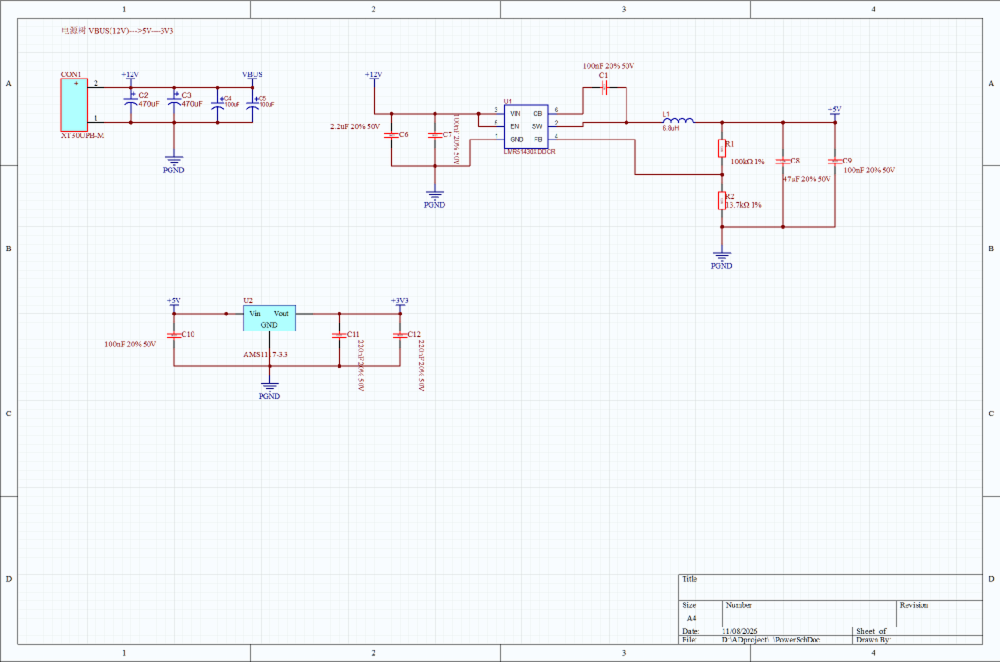
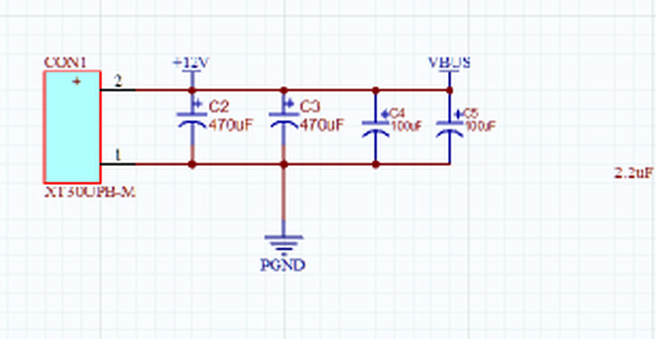
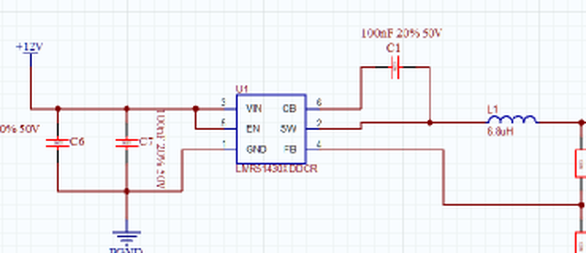
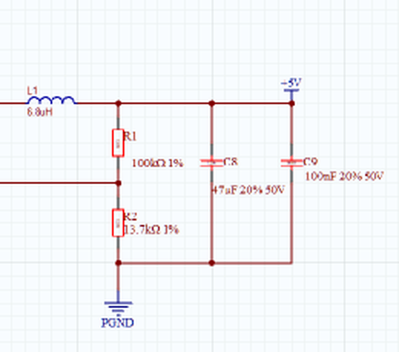
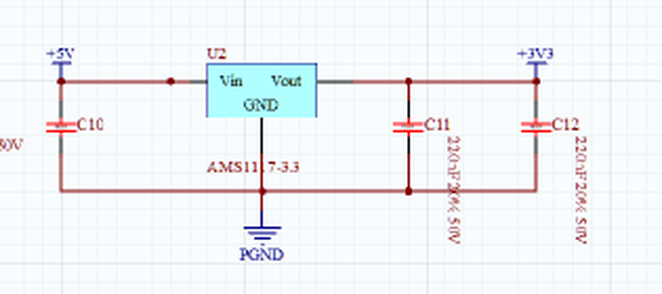

# 原理图审查报告 · FOC 电源页

| 项目 | 内容 |
|---|---|
| 审查对象 | `project/FOC/Power.SchDoc`（2026-11-08 14:53 保存版本） |
| 所属工程 | `project/FOC/FOC.PrjPcb`（当前仅含 Power.SchDoc 与 FOC.PcbDoc 两个文档） |
| 审查日期 | 2026-11-08 |
| 对照手册 | TI LMR51430（SLUSEF4A，Rev.A）、AMS1117（Advanced Monolithic Systems） |
| 审查方式 | 直接解析 SchDoc 二进制记录重建网络表（非目视看线），再逐条与器件手册比对 |

---

## 0. 结论摘要

**分压是对的。** R1 = 100 kΩ / R2 = 13.7 kΩ 构成的反馈分压，按 LMR51430 的 VREF = 0.6 V 计算得到 **4.98 V**，与 TI 手册第 16 页给出的 12 V→5 V 参考电路**完全一致**（手册原文即“RFBB = 13.7 kΩ、RFBT 计算值 100.4 kΩ，取标准值 100 kΩ”）。

**连接关系全部通过。** 全页 18 个元件、41 个引脚、7 个网络，全部引脚都落在网络上，没有悬空引脚、没有意外短路、没有孤立网络；引脚名与手册引脚定义逐脚对应正确。

**真正需要改的不是分压，而是 3.3 V 那一级。** LDO 输出电容 220 nF，比手册要求的 22 µF 小两个数量级，会让 LDO 环路失稳。

| 等级 | 数量 | 涉及 |
|---|---|---|
| 🔴 必须改 | 2 | C11/C12 输出电容、C8 电容规格不存在 |
| 🟡 建议改 | 4 | LDO 热耗、输入浪涌与过压、网络重名、输入陶瓷电容纹波 |
| 🔵 提示 | 6 | LDO 输入电容、限流余量、连接器极性、地网命名、立创料号、与选型报告的偏差 |

---

## 1. 审查方法

直接从 `Power.SchDoc` 的 OLE 复合文档中提取 `FileHeader` 记录流，解析出全部 560 条记录（元件 18、引脚 41、导线 30、节点 24、电源端口 10、参数 267），然后：

1. **引脚热点还原**：按引脚记录的 `PinConglomerate` 低两位取朝向、`PinLength` 取长度，算出引脚实际电气连接点（本图纸中引脚热点 = 引脚坐标 ± 引脚长度，已用全部 41 个引脚反向验证）。
2. **连通性判定**：导线折点互连；端点落在另一条导线内部视为 T 型连接；`Junction` 强制连通；交叉但不共点、也无节点的导线**不**连通。
3. **网络命名**：同名电源端口全局合并，得到最终网表（见 `资料/网表.csv`）。
4. 与手册的“引脚功能”“典型应用电路”“元件选型表”逐条对照。

> 说明：本审查只针对 `Power.SchDoc` 这一张图，即 12 V→5 V→3.3 V 电源树。选型报告中规划的 FOC 功率级、栅极驱动、电流采样、比较器保护等页面目前尚未在工程中建立。

---

## 2. 电路拓扑



`CON1` 12 V 输入 → 母线电容组 → `U1` LMR51430 同步降压（500 kHz）→ `+5V` → `U2` AMS1117-3.3 → `+3V3`。

| 位置 | 元件 | 作用 |
|---|---|---|
| 输入 | CON1（XT30UPB-M）、C2/C3 470 µF、C4/C5 100 µF | 12 V 输入与母线储能 |
| 输入滤波 | C6 2.2 µF、C7 100 nF | Buck 高频输入旁路 |
| 降压 | U1 LMR51430XDDCR、L1 6.8 µH、C1 100 nF | 12 V→5 V，500 kHz 同步 Buck |
| 反馈 | R1 100 kΩ、R2 13.7 kΩ | 设定 5 V 输出 |
| 输出 | C8 47 µF、C9 100 nF | 5 V 输出滤波 |
| LDO | U2 AMS1117-3.3、C10 100 nF、C11/C12 220 nF | 5 V→3.3 V |

---

## 3. 网络表（7 个网络，全部核查）

| 网络 | 引脚数 | 连接内容 | 判定 |
|---|---|---|---|
| **PGND** | 15 | CON1.1、C2/C3/C4/C5/C6/C7/C8/C9/C10/C11/C12 的 2 脚、R2.1、U1.1(GND)、U2.1(GND) | ✅ |
| **VBUS / +12V** | 9 | CON1.2、C2/C3/C4/C5/C6/C7 的 1 脚、U1.3(VIN)、U1.5(EN) | ✅（重名见 6.5） |
| **+5V** | 6 | L1.2、R1.2、C8.1、C9.1、U2.3(Vin)、C10.1 | ✅ |
| **+3V3** | 3 | U2.2(Vout)、C11.1、C12.1 | ✅ |
| **SW** | 3 | U1.2(SW)、L1.1、C1.2 | ✅ |
| **FB** | 3 | U1.4(FB)、R1.1、R2.2 | ✅ |
| **CB** | 2 | U1.6(CB)、C1.1 | ✅ |

**自动检查结果：**
- 无“引脚热点未接任何导线”的引脚（0 个）。
- 无两个不同网络被导线误连（例如 PGND 与 +12V 完全独立）。
- 无空网络、无单端悬空导线（`(260,400)` 处的节点正好落在 U2 的 Vin 引脚热点上，是有效节点，不是多余节点）。




---

## 4. 分压核算（重点）

### 4.1 原理图接法



- R1（100 kΩ，上臂 RFBT）：`+5V` → `FB`
- R2（13.7 kΩ，下臂 RFBB）：`FB` → `PGND`
- U1 的 FB 引脚单独引到 R1/R2 中点，**没有**接错到输出或地。

### 4.2 计算

LMR51430 的基准电压 VREF = 0.6 V（手册第 5 页：0.591 / 0.600 / 0.609 V，即 ±1.5%）。

```
VOUT = VREF × (1 + RFBT / RFBB)
     = 0.6 × (1 + 100 / 13.7)
     = 0.6 × 8.2993
     = 4.98 V
```

**结论：分压正确，目标 5 V，实际 4.98 V（−0.4%）。**

### 4.3 容差分析

| 条件 | VREF | R1/R2 | VOUT |
|---|---|---|---|
| 典型值 | 0.600 V | 100 k / 13.7 k | **4.98 V** |
| 最坏最小值（VREF −1.5%，R1 −1%，R2 +1%） | 0.591 V | 99 k / 13.837 k | 4.82 V（−3.6%） |
| 最坏最大值（VREF +1.5%，R1 +1%，R2 −1%） | 0.609 V | 101 k / 13.563 k | 5.14 V（+2.9%） |

总偏差约 **−3.6% / +2.9%**，对 5 V 轨（±5%）合格。此时 5 V 最低 4.82 V，与 3.3 V 的压差 1.52 V，仍大于 AMS1117 在 0.8 A 下的最大压差 1.3 V，**LDO 不会掉出调整区**（余量偏小，见 6.3）。

### 4.4 与 TI 手册参考设计逐项对照

手册第 16 页 Figure 9-1 与 Table 9-1 给出的正是 **12 V→5 V / 500 kHz** 参考电路，可以直接逐项比对：

| 项目 | TI 手册参考值 | 本原理图 | 判定 |
|---|---|---|---|
| 输入电压 | 12 V | +12V（VBUS） | ✅ |
| 输出电压 | 5 V | +5V | ✅ |
| 开关频率 | 500 kHz（LMR51430X） | LMR51430XDDCR = 500 kHz PFM | ✅ |
| 电感 L | 6.8 µH | L1 6.8 µH | ✅ |
| 自举电容 CBOOT | 0.1 µF（CB–SW） | C1 100 nF（CB–SW） | ✅ |
| 输入电容 CIN | 2.2 µF | C6 2.2 µF + C7 100 nF | ✅ |
| 输出电容 COUT | 2 × 22 µF = 44 µF | C8 47 µF + C9 100 nF | ⚠️ 标称对，规格需核（6.2） |
| 上臂 RFBT | 100 kΩ | R1 100 kΩ 1% | ✅ |
| 下臂 RFBB | 13.7 kΩ | R2 13.7 kΩ 1% | ✅ |
| 使能 EN | 可接 VIN | 接 +12V | ✅（手册原文允许） |

### 4.5 引脚定义对照

**U1 LMR51430XDDCR（SOT-23-6，DBV）**

| 脚 | 手册名称 | 手册功能 | 本图连接 | 判定 |
|---|---|---|---|---|
| 1 | GND | 功率地，接 CIN/COUT 地 | PGND | ✅ |
| 2 | SW | 开关输出，接电感 | L1 + C1（自举回 SW） | ✅ |
| 3 | VIN | 输入，就近接 CIN | +12V | ✅ |
| 4 | FB | 反馈输入，接分压，禁止对地短路 | R1/R2 中点 | ✅ |
| 5 | EN | 精密使能，可接 VIN | +12V | ✅ |
| 6 | CB | 自举电容，100 nF 到 SW | C1 → SW | ✅ |

**U2 AMS1117-3.3（SOT-223）**

| 脚 | 手册名称 | 本图连接 | 判定 |
|---|---|---|---|
| 1 | GND / ADJ | PGND | ✅ |
| 2 | VOUT（含散热片） | +3V3 | ✅ |
| 3 | VIN | +5V | ✅ |



---

## 5. 已核对通过的项目

- ✅ 反馈分压取值与接法（4.98 V）。
- ✅ 自举电容接在 CB 与 SW 之间，容值 100 nF，与手册 “Connect a high quality 100-nF capacitor from this pin to the SW pin” 一致。
- ✅ EN 直接接 VIN，手册明确允许（“This pin can be tied to VIN”），且 EN 绝对最大值为 VIN+0.3 V，不超限。
- ✅ 输入/输出电容、储能电感、二极管（同步整流，无需外部续流管）配置正确，无多余元件、无需外部补偿（内部补偿）。
- ✅ 电感 L1（6.8 µH，Irms 5 A，Isat 6 A）满足手册 “4-A RMS、5-A 饱和” 的选型要求。
- ✅ 输入 12 V 对 U1 的 36 V 上限、母线上 35 V 电解电容均有 3 倍以上余量。
- ✅ 3.3 V 负载若在 0.5 A 以内，AMS1117 压差 1.7 V 处于正常调整区。
- ✅ 所有电源端口、导线、节点语法正确，Altium 打开不会报“网络存在多个名称”以外的结构性错误。

---

## 6. 问题清单

### 🔴 6.1【必须改】LDO 输出电容 220 nF，比手册要求小两个数量级

**位置**：C11、C12（U2 输出端）
**现状**：C11 = 220 nF，C12 = 220 nF，合计 440 nF。
**手册依据**：

> “The circuit design used in the AMS1117 series requires the use of an output capacitor as part of the device frequency compensation. The addition of **22 µF solid tantalum** on the output will ensure stability for all operating conditions.”
> —— AMS1117 Data Sheet, APPLICATION HINTS / Stability

**影响**：AMS1117 是依靠输出电容做频率补偿的 LDO，输出电容同时是环路的一个极点。容量小两个数量级，相位裕度会严重不足，典型现象是输出叠加几百 kHz 到几 MHz 的振荡、纹波异常、负载跳变时过冲大；轻载时可能“看起来正常”，温度或批次一变就发作。这是本图最需要修的一处。

**建议**：改为 **≥22 µF**（两颗 10 µF 或一颗 22 µF 陶瓷，X5R/X7R，16 V 以上）；若沿用钽电容按 22 µF 选。**不要**用 0603 的 220 nF 顶替。
**附带**：C11/C12 的注释“220nF 20% 50V”很可能是笔误（想写 22 µF）。改完请同步改 Comment 与 BOM。

---

### 🔴 6.2【必须改】C8 标注“47 µF / 50 V / 1206”，这个规格组合不存在

**位置**：C8（+5V 输出滤波）
**现状**：封装 C1206，Comment “47uF 20% 50V”。
**问题**：
1. 1206 封装、50 V 耐压的陶瓷电容，市面最大约 2.2–4.7 µF；47 µF 的 1206 陶瓷通常只有 6.3–10 V 耐压。这个组合**买不到**，按现状下单会卡在 BOM 上。
2. 即使改成 47 µF/10 V，5 V 直流偏压下 X5R/X7R 的容量衰减通常 40%–60%，实际有效容量可能只剩 20–28 µF，低于手册要求的 44 µF。
3. 5 V 输出用 50 V 耐压也没有必要，白白牺牲容量与体积。

**建议**：按手册 Table 9-1 用 **2 × 22 µF / 25 V 1206**（推荐），或 1 × 47 µF / 10 V 1210，并按厂家偏压曲线核对 5 V 下的有效容量；C9 的 100 nF 保留。

---

### 🟡 6.3【建议】AMS1117 热耗：3.3 V 负载超过约 0.5 A 会超结温

**依据**：AMS1117 手册 PD = (VIN − VOUT) × IOUT，SOT-223 的 θJA = 90 °C/W（铺铜良好时最低 46 °C/W），SOT-223 允许功耗 1.2 W，TJ 上限 125 °C。
本图压差固定为 5 V − 3.3 V = **1.7 V**：

| 3.3 V 负载 | 功耗 | 温升（90 °C/W） | TJ @25 °C | TJ @40 °C |
|---|---|---|---|---|
| 0.2 A | 0.34 W | 31 °C | 56 °C | 71 °C |
| 0.4 A | 0.68 W | 61 °C | 86 °C | 101 °C |
| 0.5 A | 0.85 W | 77 °C | 102 °C | 117 °C |
| 0.7 A | 1.19 W | 107 °C | 132 °C ❌ | 147 °C ❌ |
| 1.0 A | 1.70 W | 153 °C ❌ | 超 1.2 W 上限 ❌ | ❌ |

**建议**：把 3.3 V 负载控制在 **≤0.5 A**（且需保证 SOT-223 散热片铜箔面积），并在原理图上注明该限制；若 3.3 V 要带更大电流（例如直接给栅极驱动器数字侧或大电流外设），改用同步 Buck（如 TLV62569/TPS62132 一类）替代线性 LDO。

---

### 🟡 6.4【建议】输入端 1140 µF 无软启动/无保险丝/无 TVS

**现状**：C2+C3（470 µF ×2）+ C4+C5（100 µF ×2）= **1140 µF** 直接并在 XT30 输入上，插入瞬间对电容充电：

- 储能 ½CV² = ½ × 1140 µF × 12² ≈ **0.082 J**
- 若回路电阻 0.1 Ω，时间常数约 114 µs，峰值电流可达 **上百安**（受电源内阻与线阻限制，实际几十安）

**影响**：插头打火、触点烧蚀；台架电源 OCP 跳闸或进入限流导致上电失败。
**另外**：母线 35 V 电容与 U1 的 38 V 绝对最大值，对“电机回馈”并不安全——FOC 刹车/反拖时能量会倒灌进 12 V 母线，很容易顶到 40 V 以上。

**建议**：
1. 加 **TVS（SMBJ15A 或 SMBJ18A）** 钳位母线；
2. 加 **保险丝**（或自恢复 PPTC）限制短路与浪涌；
3. 需要抑制插入浪涌时，加 **NTC 或预充电阻 + 继电器/MOS**。
（选型报告里已有“约 14.35 V 母线过压 → Break”的比较器方案，但那是软件级保护，救不了 100 µs 级的浪涌和回馈尖峰。）

---

### 🟡 6.5【建议】VBUS 与 +12V 是同一网络上的两个电源端口

**现状**：`+12V`（位于 x=150 与 x=430 两处）和 `VBUS`（x=290）都接在同一条导线上，Altium 会把它当成**一个网络**，并按优先级只保留一个网络名（工程选项 `PowerPortNamesTakePriority=0`）。
**影响**：网表里只会出现 `+12V` 或 `VBUS` 之一，PCB 上网络名与你预期可能不一致；后续若按名字做网络类/规则（比如给 VBUS 单独设线宽），会失效。
**建议**：统一成一个名字（推荐保留 `+12V`，或按选型报告叫 `VM`），另一个删除或改成普通文字注释。

---

### 🟡 6.6【建议】输入陶瓷电容 C6 的纹波电流需要核对

**计算**：12 V→5 V，D = 5/12 = 0.417，满载 3 A 时输入电容纹波电流

```
I_CIN(RMS) ≈ IOUT × √(D × (1 − D)) = 3 × √(0.417 × 0.583) ≈ 1.48 A
```

**影响**：C6 是 0603 的 2.2 µF/50 V，单颗额定纹波电流通常在 1 A 量级，长期满载会发热、容量衰减甚至开裂。
**建议**：核对所选型号的额定纹波电流；若不足，改用 0805/1206 的 2.2 µF，或并联两颗。另注意 2.2 µF/50 V 陶瓷在 12 V 偏压下有效容量会掉 30%–50%。

---

### 🔵 6.7【提示】LDO 输入只有 100 nF

C10 = 100 nF。AMS1117 手册未强制要求输入电容，但实际应用建议 ≥4.7 µF 并紧贴 U2 放置（+5 V 端虽有 C8 47 µF，但距离较远）。建议 C10 改 4.7 µF + 100 nF。

### 🔵 6.8【提示】满载时电感峰值电流距最小限流点仅 7%

- 电感纹波 ΔIL = VOUT(VIN−VOUT)/(VIN·L·fSW) = 5×7/(12×6.8 µH×500 kHz) = **0.858 A**，KIND = 28.6%（手册要求 20%–60%，合格）。
- 3 A 满载时峰值 = 3 + 0.429 = **3.43 A**；而手册给出高边峰值限流最小值为 **3.67 A**，余量仅 **6.6%**。
- 若母线升到 24 V，峰值约 3.58 A；36 V 时约 3.63 A，几乎贴住最小限流点。

**建议**：12 V 固定输入、3 A 以内没有问题；若以后要跑宽压输入并满载，注意此处不要误触发限流。

### 🔵 6.9【提示】CON1 引脚极性与封装需核对

本图 `CON1.1 = PGND`、`CON1.2 = +12V`，且图上的 “+ / −” 标注也与之一致（+ 在 2 脚侧）。这一致性没有问题，但**请核对 XT30 封装焊盘的 1/2 脚编号与丝印 “+” 是否也对得上**——封装与符号编号若反了，实物就是电源反接，后果严重。另外确认 `XT30UPB-M` 是公头，与你的电池/电源线母头能配对。

### 🔵 6.10【提示】地网命名要与后续页面统一

本页全部使用 `PGND`。若后续功率级、驱动页用 `GND`，两个网络**不会自动连通**（除非放 0 Ω 或网络标号）。建议现在就把地名规范定下来：要么全板 `GND`，要么 `PGND` 与 `AGND` 单点连接并明确写出连接器件。

### 🔵 6.11【提示】18 个元件里有 12 个没有绑定立创料号

已有立创料号：C2/C3（C72519）、C4/C5（C2887272）、L1（C408449）、U1（C5185863）。
**没有料号**：CON1、U2、C1、C6、C7、C8、C9、C10、C11、C12、R1、R2。
**影响**：立创贴片（SMT）下单必须有 `Supplier Part`，否则这些位号无法自动配单，只能手焊或手工指定。
**建议**：在 Altium 里补齐 SupplierPart / ManufacturerPart / Datasheet 三个参数，再导出 BOM。

### 🔵 6.12【提示】与《选型报告》的三处偏差

| 项目 | 选型报告 | 本原理图 | 说明 |
|---|---|---|---|
| 5 V Buck | LMR51420XDDCR（2 A） | LMR51430XDDCR（3 A） | 同封装同引脚，升级没问题，BOM 与手册要以 LMR51430 为准 |
| 5 V 隔离跳线 | 规划 `JP_CORE_5V`（0 Ω 或跳线） | **没有** | 核心板 USB 调试时会经 5 V 线回灌底板，建议补回跳线 |
| 测试点 | 规划 5V/3V3/GND 测试点 | **没有** | 建议至少补 +5V、+3V3、PGND 各 1 个 |

另外选型报告里规划了 TPS61040（10 V 栅极电源）、TLV1704（过压/过流比较）、INA181（电流采样），本页都还没有，属于后续页面，不算本页问题。

---

## 7. 待确认事项

1. **3.3 V 实际负载电流是多少？** 这决定 6.3 的热耗是否可接受（≤0.5 A 可以直接用 AMS1117）。
2. **母线最高电压是多少？** 若只是 12 V 台架，35 V 电容足够；若电池或回馈会把母线推到 20 V 以上，需重新核算 6.4。
3. **XT30 公母头与封装编号**（见 6.9）。
4. **`+5V` 是否还要给核心板以外的模拟电路供电？** 目前 U1 选的是 PFM 版本（LMR51430X），轻载时 5 V 上会有低频纹波；若 5 V 直接供运放/比较器参考，可考虑换成 FPWM 版本 `LMR51430XFDDCR`（同封装同价，pin-to-pin）。

---

## 8. 修改清单（可直接照着改）

| # | 位号 | 现在 | 改成 |
|---|---|---|---|
| 1 | C11、C12 | 220 nF | 22 µF（或 2×10 µF）X5R/X7R ≥16 V |
| 2 | C8 | 47 µF / 50 V / 1206 | 2×22 µF / 25 V / 1206（或核对偏压后的 47 µF/10 V 1210） |
| 3 | C10 | 100 nF | 4.7 µF + 100 nF |
| 4 | 网络名 | VBUS 与 +12V 并存 | 统一为一个 |
| 5 | 输入 | 无 | 加 TVS + 保险丝（+ NTC 可选） |
| 6 | 其余 12 个位号 | 无立创料号 | 补 SupplierPart |

---

## 9. 附录

- 资料与手册：见 [`资料/资料索引.md`](资料/资料索引.md)
- 完整网表：见 [`资料/网表.csv`](资料/网表.csv)
- 全页截图：`资料/原理图全页.png`
- 审查脚本：见 [`脚本/README.md`](脚本/README.md)（`python 脚本/netlist.py` 可复现整张网表与体检结论）
- LMR51430 手册关键页：第 3 页（引脚功能）、第 5 页（基准电压/限流）、第 16 页（12 V→5 V 参考电路与选型表）
- AMS1117 手册关键页：第 1 页（引脚）、第 3 页（功耗上限）、第 4 页（稳定性与输出电容要求）、第 5 页（热耗计算）
